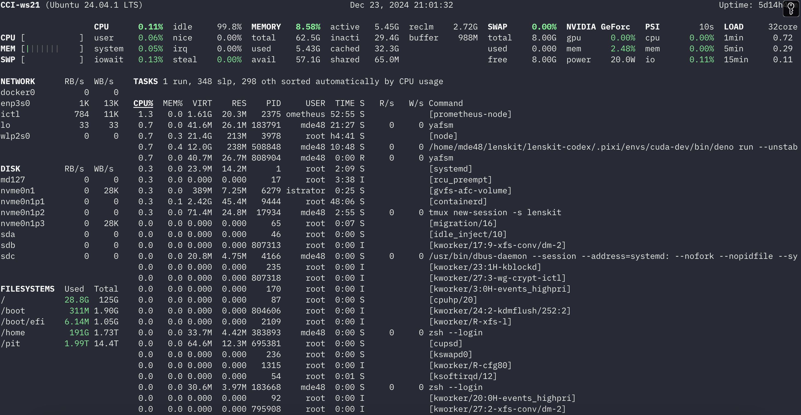

# yet another fine system monitor



To install:

```console
$ cargo install --locked yafsm
```

## Background

[Glances](https://glances.readthedocs.io/) is a very nice system monitor.  I
find it strikes an optimal balance between density and legibility, and it's my
go-to monitor for watching utilization of my compute nodes etc.

However, Glances is quite slow — it usually uses about 25% of a CPU core just to
display the system monitor dashboard.

This is my attempt to write yet another fine system monitor, modeled after
Glances but with

- fewer features
- more bugs
- much less resource usage

## Platforms

`yafsm` is at its best on Linux, supporting a wide range of system statistics as
well as NVidia GPU performance.

On other platforms, `yafsm` can use the [`sysinfo`](https://docs.rs/sysinfo)
crate.  This mode has far fewer features.  I have no plans to remove it, but
primary development focuses on Linux features.

## User Interface

Press `h` when the application is running to see help.
